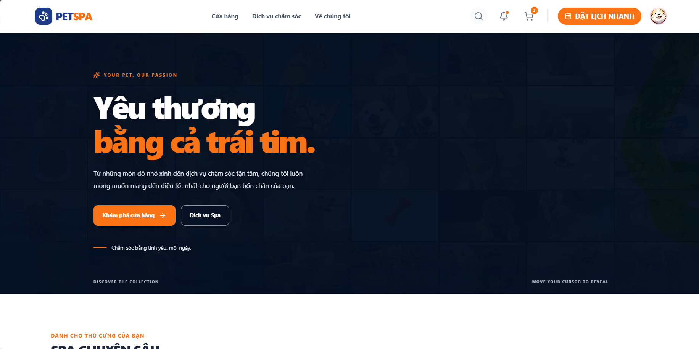
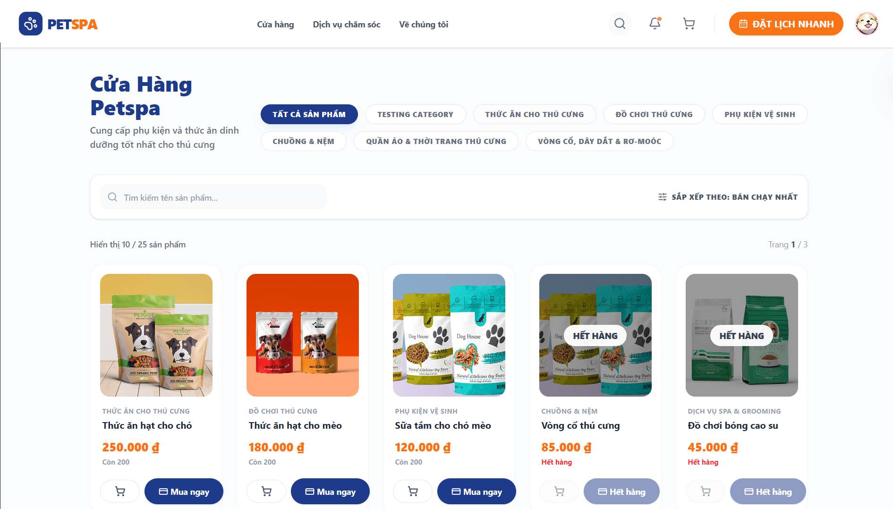
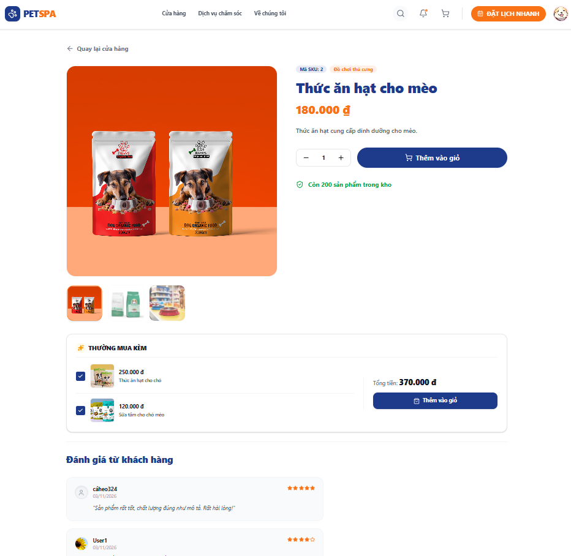
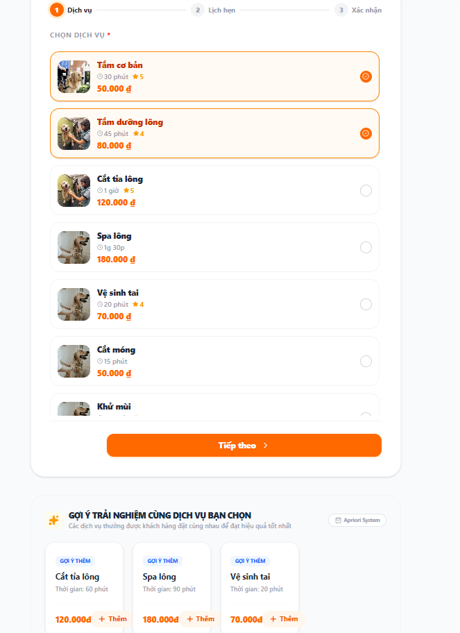
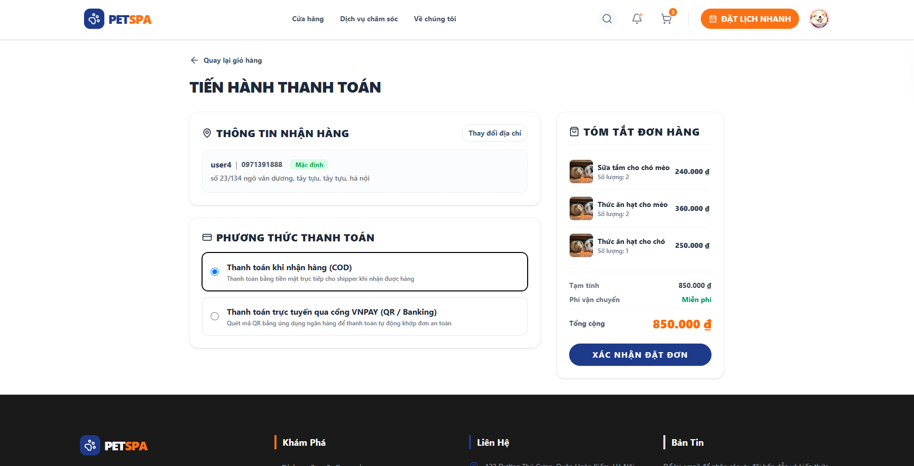
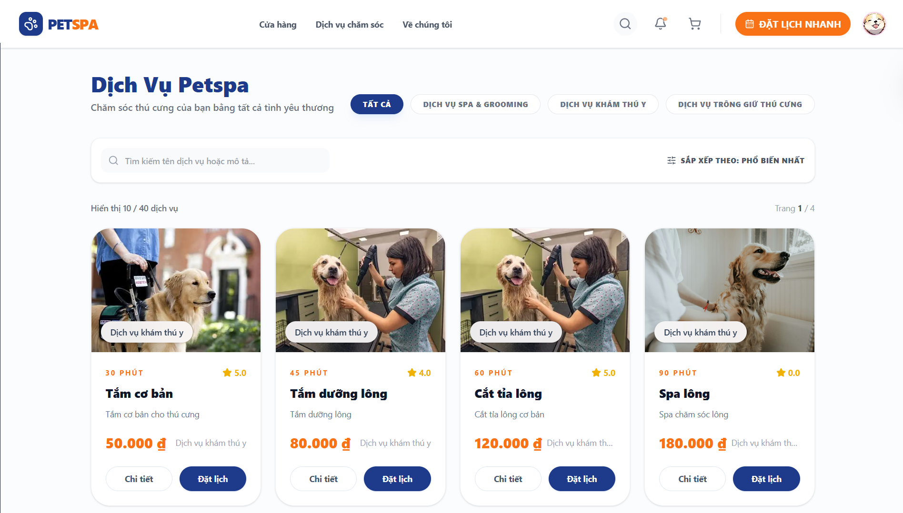
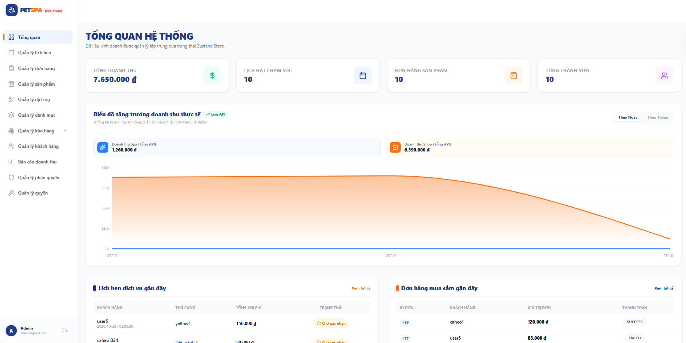
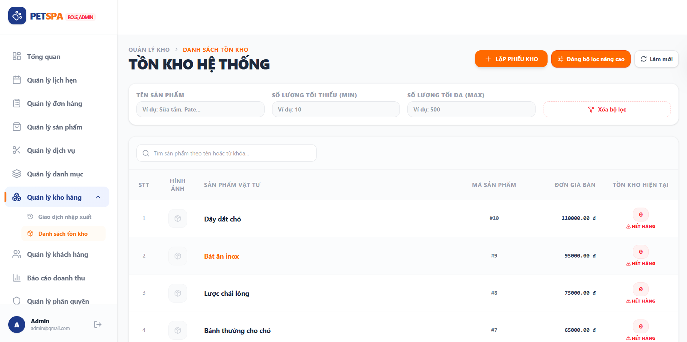
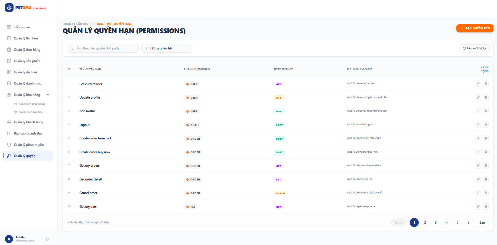

# PetSpa & PetShop

**A web platform for selling pet supplies and booking pet spa and grooming services, with VNPay payment integration and product recommendations powered by the Apriori algorithm.**


---

## Table of Contents

- [Project Overview](#project-overview)
- [Key Features](#key-features)
- [Screenshots / Demo](#screenshots--demo)
- [Technology Stack](#technology-stack)
- [System Architecture](#system-architecture)
- [Recommendation System (Apriori)](#recommendation-system-apriori)
- [Project Structure](#project-structure)
- [Getting Started](#getting-started)
- [Related Documentation](#related-documentation)

---

## Project Overview

**PetSpa & PetShop** is an e-commerce and service-booking system for pet stores. It combines two business areas on a single platform:

- **PetShop**: sells products (food, accessories, etc.) with a shopping cart, order placement, COD or VNPay payment, and inventory management.
- **PetSpa**: customers keep pet profiles, choose spa and grooming services, and book an available time slot.

The system consists of:

| Component | Role |
|---|---|
| `frontend/` | React UI for customers and the admin dashboard |
| `backend/` | NestJS REST API with JWT authentication, permission-based authorization, and MySQL |
| `backend/recommendation/` | Python scripts that train Apriori association rules and export rule files for the API |

---

## Key Features

### Customers

- **Accounts**: register, log in, and log out using JWT; view and update the profile; upload an avatar.
- **Shop**: browse product lists and details, filter by category, multiple images per product.
- **Cart and orders**: add, update, and remove cart items; checkout; manage multiple shipping addresses and a default address; view order history and details; cancel orders.
- **Payment**: supports **COD** and **VNPay**. VNPay orders left unpaid for more than 15 minutes are cancelled automatically.
- **Spa**: browse services, view details and featured services; book by pet and time slot; the system returns already-booked slots to prevent double booking; view and cancel bookings.
- **Pet profiles**: create, edit, view, activate, and deactivate pets.
- **Reviews**: review products after purchase and services after use.
- **Smart recommendations**: suggests products and services that are frequently bought or booked together (Apriori).
- **UI**: responsive layout with 3D elements on the home and about pages (React Three Fiber).

### Admin

- **Dashboard** and **revenue report**.
- Manage **products** (with images), **categories**, and **services** (with images).
- Manage **orders** (status updates) and **spa bookings**.
- Manage **inventory**: stock in, stock out, stock adjustment, and transaction history.
- Manage **users**, **roles**, **permissions**, and dynamic **menus**.

### System

- Permission-based authorization is enforced globally on the backend, not only by hiding pages in the frontend.
- Automatic auditing of the creator and last modifier on records.
- A scheduled (cron) job cancels VNPay orders that exceed the payment time limit.

---

## Screenshots / Demo

| Home | Shop | Product Detail |
|:---:|:---:|:---:|
|  |  |  |

| Spa Booking | Cart and Checkout | Product Recommendations (Apriori) |
|:---:|:---:|:---:|
|  |  |  |

| Admin Dashboard | Inventory Management | Permission Management |
|:---:|:---:|:---:|
|  |  |  |


---

## Technology Stack

### Backend

| Category | Technology |
|---|---|
| Framework | NestJS 11, TypeScript 5 |
| Database | MySQL (`mysql2`), TypeORM 0.3 |
| Authentication / security | `@nestjs/jwt`, Passport (`passport-jwt`), `bcrypt` |
| Validation | `class-validator`, `class-transformer`, `joi` |
| Scheduled jobs | `@nestjs/schedule` |
| Logging | `winston` |
| Payment | VNPay (sandbox) |
| Testing / code quality | Jest, Supertest, ESLint, Prettier |

### Frontend

| Category | Technology |
|---|---|
| Framework | React 19, Vite 7 |
| Routing | React Router 7 |
| State management | Zustand 5 |
| Forms and validation | React Hook Form, Zod |
| HTTP client | Axios |
| UI | Tailwind CSS 4, Lucide React |
| 3D | Three.js, `@react-three/fiber`, `@react-three/drei` |

### Machine Learning

| Category | Technology |
|---|---|
| Language | Python |
| Libraries | `pandas`, `mlxtend` (Apriori and association rules), `mysql-connector-python`, `PyYAML` |

---

## System Architecture

### Overview

```text
+---------------------------+   REST/JSON + Bearer JWT   +------------------------------+
|  Frontend (React + Vite)  | -------------------------> |  Backend (NestJS, /api/v1)   |
|  Zustand, Axios           | <------------------------- |  Guards, Services, TypeORM   |
+---------------------------+                            +-------+-----------+----------+
        |                                                        |           |
        | payment redirect                                       v           v
        v                                                  +---------+  +------------------------+
+---------------+        return / callback                 |  MySQL  |  | recommendation/*/      |
|  VNPay        | ---------------------------------------> +----^----+  | association_rules.json |
+---------------+                                               |       +-----------^------------+
                                                                | reads data        | writes rules
                                                         +------+-------------------+------+
                                                         | Python training (Apriori)       |
                                                         +---------------------------------+
```

### Backend: modular monolith

The backend is organized into **business modules** under `src/modules/`. Each module contains its own layers:

```text
Controller  ->  Service (interface + Impl)  ->  Repository  ->  Entity (TypeORM)
   |                  |
   +-- DTO (validate) +-- Mapper (Entity <-> DTO)
```

- **Controller**: receives HTTP requests, calls the service, and returns responses through `VsResponseUtil` in a consistent shape: `{ statusCode, body: { status, data } }`.
- **Service**: contains business logic and is injected via a token (`PROVIDER_TOKEN`) to separate the interface from its implementation.
- **Repository / Entity**: access MySQL through TypeORM.

**Global components** (registered in `AppModule`):

| Component | Role |
|---|---|
| `JwtAuthGuard` | Authenticates JWT on every request (except the list of public routes) |
| `PermissionsGuard` | Checks access based on the role's permissions |
| `ValidationPipe` | `whitelist` + `forbidNonWhitelisted` + `transform` for incoming data |
| `AuditInterceptor` + `AuditSubscriber` | Automatically fills in the creator and last modifier on records |
| `OrderExpirationScheduler` | Runs every minute and cancels VNPay orders pending for more than 15 minutes |

**Main modules**: `auth`, `users`, `roles`, `permissions`, `menu`, `catalogue` (`categories`, `products`, `services`), `inventory`, `pets`, `cart`, `shipping`, `orders`, `payments`, `bookings`, `reviews`, `files`, `recommendation`.

### Frontend: feature modules

The frontend is split by feature under `src/modules/<feature>/`. Each feature contains `api/` (backend calls), `store/` (Zustand), `pages/`, `components/`, and `validators/` (Zod).

- A shared Axios instance automatically attaches `Authorization: Bearer <token>` (the token is stored in `localStorage` under the key `petspa_token`); on a `401` response it clears the session and redirects to the login page.
- Routes are protected by `AdminRoute`, `RoleRoute`, and `CustomerRouteGuard`.
- The API base URL is configured through the `VITE_API_URL` variable.

### Main business flows

```text
Cart -> Order -> (COD) completed
               -> (VNPay) redirect to payment gateway -> return/callback -> update status
                 +- unpaid after 15 minutes -> cron job cancels the order

Pet + Service + Date/Time -> Check booked slots -> Booking -> Update status
```

---

## Recommendation System (Apriori)

The recommendation system is based on **association rules** mined with the **Apriori** algorithm, following the idea that "customers who buy A and B often also buy C". There are **two independent models**:

| Model | Training data | Transaction | Folder |
|---|---|---|---|
| **Product** recommendations | `tbl_order_details` | one order (`order_id`) containing `product_id`s | `backend/recommendation/product/` |
| **Service** recommendations | `tbl_booking_details` JOIN `tbl_bookings` | one booking (`booking_id`) containing `service_id`s | `backend/recommendation/service/` |

### Metrics of a rule `A -> B`

| Metric | Meaning |
|---|---|
| **Support** | Share of transactions that contain both A and B |
| **Confidence** | Among transactions containing A, the share that also contain B |
| **Lift** | How much more often A and B occur together than if they were independent (> 1 means a positive association) |

### Pipeline

```text
 MySQL (order/booking details)
        |  fetch
        v
 Build the basket matrix (transaction x item, True/False)
        |
        v
 Apriori (min_support = 0.01)  ->  frequent itemsets
        |
        v
 association_rules (min_confidence = 0.10, fallback 0.01)
        |  sorted by confidence, then lift, descending
        v
 |--> association_rules.json   (loaded into memory by the backend to serve the API)
 +--> model.pkl                (frequent itemsets + rules + parameters,
                                used for cross-checking and testing)
```

**Default parameters** in `training.py`: `MIN_SUPPORT = 0.01`, `MIN_CONFIDENCE = 0.10`. If no rules are found, the script retries with a confidence of `0.01`; if there are still none, it saves an empty rule set.

**Rule format** in `association_rules.json`:

```json
{
  "antecedent": [1],
  "consequent": [2],
  "confidence": 1.0,
  "support": 0.6,
  "lift": 1.0
}
```

### Serving recommendations in the backend

1. At build time, `nest-cli.json` copies the `recommendation/` folder into `dist/recommendation/`.
2. At startup, `RecommendationServiceImpl` loads both `association_rules.json` files into memory (file read errors are logged and an empty list is used).
3. For the `itemIds` list sent by the client, the service scans the rules: for every rule whose **entire `antecedent` is contained in `itemIds`**, the `consequent` items not already in `itemIds` are added to the result (without duplicates, following the rule order, which is sorted by confidence).

**API**

| Method | Endpoint | Description |
|---|---|---|
| `POST` | `/api/v1/products/recommendations` | Recommend products |
| `POST` | `/api/v1/services/recommendations` | Recommend services |

Request:

```json
{ "itemIds": [1, 3] }
```

Response (example using the sample rule set included in the repo):

```json
{
  "statusCode": 200,
  "body": {
    "status": "SUCCESS",
    "data": { "recommendedItemIds": [2, 5, 4] }
  }
}
```

The frontend calls these two endpoints in `modules/recommendations/` (`AprioriService.js` and the Zustand store `apioriStore.js`) and displays the results through the `RecommendProducts.jsx` component (on the product detail page) and `RecommendService.jsx`.

### Training and testing

```bash
cd backend/recommendation/product      # or .../service
pip install pandas mlxtend mysql-connector-python pyyaml
python training.py     # train and export association_rules.json + model.pkl
python test.py         # enter "1,3" to compare results between the JSON file and model.pkl (MATCH / MISMATCH)
```

---

## Project Structure

```text
PetspaPetshop/
|-- backend/                          # NestJS REST API
|   |-- src/
|   |   |-- main.ts                   # Bootstrap: CORS, ValidationPipe, port
|   |   |-- app.module.ts             # Registers modules, TypeORM, global guards/interceptors
|   |   |-- common/                   # Shared components
|   |   |   |-- auditing/             # Creator/modifier tracking
|   |   |   |-- base/                 # Response envelope, status
|   |   |   |-- constants/            # Enums, URL constants, provider tokens
|   |   |   |-- decorators/  dto/  entities/  exceptions/  filters/
|   |   |   |-- specification/  validators/  utils/
|   |   |   +-- utils/scheduled/      # Cron job that cancels expired VNPay orders
|   |   |-- config/                   # VNPay, CORS, auditing, OpenAPI, static resources
|   |   +-- modules/
|   |       |-- auth/                 # Login/register, JWT strategy, guards
|   |       |-- users/  roles/  permissions/  menu/
|   |       |-- catalogue/            # categories, products, services
|   |       |-- inventory/            # Stock in/out/adjustment
|   |       |-- pets/  cart/  shipping/
|   |       |-- orders/  payments/    # Orders, VNPay
|   |       |-- bookings/             # Spa booking
|   |       |-- reviews/  files/
|   |       +-- recommendation/       # Serves recommendations from Apriori rules
|   |-- recommendation/               # Apriori training (Python)
|   |   |-- product/                  # training.py, test.py, association_rules.json, model.pkl
|   |   +-- service/                  # (same structure for services)
|   |-- docs/                         # API, architecture, business rules, database docs
|   |-- uploads/                      # Uploaded images (avatars, products)
|   |-- test/                         # e2e configuration
|   |-- .env.example
|   +-- package.json
|
|-- frontend/                         # React + Vite
|   |-- public/                       # logo, banner, icons
|   |-- src/
|   |   |-- App.jsx                   # Route definitions
|   |   |-- main.jsx
|   |   |-- app/                      # config (URL constants), router guards
|   |   |-- infrastructure/api/       # Axios instance + interceptors
|   |   |-- layouts/                  # public (Header/Footer) and admin (Sidebar)
|   |   |-- modules/                  # By feature: auth, products, services, cart,
|   |   |                             # orders, bookings, pets, reviews, inventory,
|   |   |                             # recommendations, dashboard, reports, ...
|   |   |-- shared/                   # shared components, hooks, utils, validators
|   |   +-- styles/
|   |-- .env                          # VITE_API_URL
|   +-- package.json
|
+-- README.md
```

---

## Getting Started

### Prerequisites

- **Node.js** 20 or later, and **npm**
- **MySQL** 8 or later
- **Python** 3.11 or later (only needed to retrain the Apriori model)

### 1. Clone the repository

```bash
git clone https://github.com/ChinhNguyen1105/PetspaPetshop.git
cd PetspaPetshop
```

### 2. Database

Create a MySQL database (the default name in the code is `petspa3`):

```sql
CREATE DATABASE petspa3 CHARACTER SET utf8mb4 COLLATE utf8mb4_unicode_ci;
```

> **Note**: TypeORM is configured with `synchronize: false`, and the repository does not currently include an SQL or migration script. You need to create the schema (the `tbl_*` tables) before running the backend.

### 3. Run the backend

```bash
cd backend
npm install
```

Create a `.env` file in `backend/` with the variables the code uses:

```env
# Server
PORT=3000

# Database
DB_HOST=localhost
DB_PORT=3306
DB_USERNAME=root
DB_PASSWORD=your_password
DB_NAME=petspa3

# JWT
JWT_SECRET=change-me-to-a-long-random-string
JWT_REFRESH_EXPIRATION=7d

# VNPay (sandbox)
VNPAY_TMN_CODE=your_tmn_code
VNPAY_HASH_SECRET=your_hash_secret
VNPAY_URL=https://sandbox.vnpayment.vn/paymentv2/vpcpay.html
VNPAY_RETURN_URL=http://localhost:5173/payment/vnpay/return

# Upload
UPLOAD_PATH=./uploads
```

> **Security**: never commit the `.env` file or real VNPay credentials to GitHub.

Start in development mode:

```bash
npm run start:dev
```

The backend runs at `http://localhost:3000` by default. Other useful commands:

| Command | Description |
|---|---|
| `npm run build` | Compile and copy `recommendation/` into `dist/` |
| `npm run start:prod` | Run the production build (`node dist/main`) |
| `npm run test` | Run unit tests (Jest) |
| `npm run test:e2e` | Run e2e tests |
| `npm run lint` | ESLint (runs with `--fix`, so review the diff before committing) |

### 4. Run the frontend

```bash
cd frontend
npm install
```

Create or edit `frontend/.env` to point to the backend:

```env
VITE_API_URL=http://localhost:3000/api/v1
```

```bash
npm run dev
```

The frontend runs at `http://localhost:5173` (the backend CORS configuration already allows this origin).

| Command | Description |
|---|---|
| `npm run dev` | Start the dev server (Vite, exposed to the LAN) |
| `npm run build` | Production build |
| `npm run preview` | Preview the production build |
| `npm run lint` | ESLint |

### 5. (Optional) Retrain the recommendation model

See [Recommendation System (Apriori)](#recommendation-system-apriori). After generating new `association_rules.json` files, run `npm run build` again (or restart the backend) to load the new rules.

---

## Related Documentation

Documentation lives in [`backend/docs/`](backend/docs/):

| Document | Contents |
|---|---|
| [`PRD.md`](backend/docs/PRD.md) | Product scope, requirements, and open decisions |
| [`API.md`](backend/docs/API.md) | API conventions, base URL, response envelope |
| [`ARCHITECTURE.md`](backend/docs/ARCHITECTURE.md) | Modular monolith architecture and cross-module flows |
| [`BUSINESS-RULES.md`](backend/docs/BUSINESS-RULES.md) | Server-side business rules |
| [`DATABASE.md`](backend/docs/DATABASE.md) | Conceptual data model |


Per-module documentation (in [`backend/docs/modules/`](backend/docs/modules/)):
[auth](backend/docs/modules/auth.md),
[users](backend/docs/modules/users.md),
[roles](backend/docs/modules/roles.md),
[permissions](backend/docs/modules/permissions.md),
[products](backend/docs/modules/products.md),
[categories](backend/docs/modules/categories.md),
[services](backend/docs/modules/services.md),
[inventory](backend/docs/modules/inventory.md),
[pets](backend/docs/modules/pets.md),
[cart](backend/docs/modules/cart.md),
[orders](backend/docs/modules/orders.md),
[payments](backend/docs/modules/payments.md),
[bookings](backend/docs/modules/bookings.md),
[reviews](backend/docs/modules/reviews.md),
[addresses](backend/docs/modules/addresses.md),
[files](backend/docs/modules/files.md),
[notifications](backend/docs/modules/notifications.md),
[recommendations](backend/docs/modules/recommendations.md)